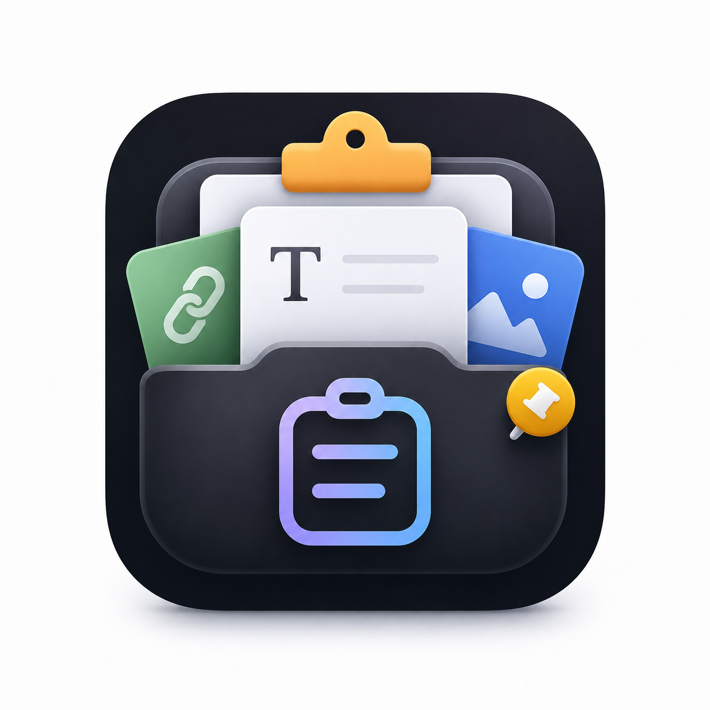

# Copied

A clipboard history for your Mac. It lives in the menu bar, remembers what you copy, and brings it back with one shortcut.

Press <kbd>⌘</kbd> <kbd>⇧</kbd> <kbd>V</kbd> over any app, find the item, and press <kbd>Return</kbd> to paste it.

[Read the case study](https://www.dealwithmuhammad.com/work/copied)

## What it does

- Keeps the text and images you copy, with the name of the app each one came from
- Keeps your pinned items plus the latest 50 others, and moves repeated text back to the top
- Marks links, emails, colours and code with a badge, and has a search box
- Opens near your pointer, on every Space and over full-screen apps
- Copies new screenshots automatically, which you can turn off
- Stays on your Mac: there's no networking code, and history is saved to `~/Library/Application Support/Copied/history.json`

## Shortcuts

| Keys | Action |
| --- | --- |
| <kbd>⌘</kbd> <kbd>⇧</kbd> <kbd>V</kbd> | Open Copied |
| <kbd>↑</kbd> <kbd>↓</kbd> | Move through the list |
| <kbd>Return</kbd> | Paste the selected item |
| <kbd>⌘</kbd> <kbd>1</kbd> to <kbd>9</kbd> | Pick an item by its number |
| <kbd>⌘</kbd> <kbd>C</kbd> | Copy without pasting |
| <kbd>⌘</kbd> <kbd>⌫</kbd> | Delete the selected item |
| <kbd>Esc</kbd> | Close |

## Permissions

Pasting into another app sends a synthetic <kbd>⌘</kbd> <kbd>V</kbd>, so Copied needs Accessibility permission. The first-run window walks you through it.

## Building it

This repo holds the Swift sources and assets, but not an Xcode project yet. To build it:

1. Create a new macOS app in Xcode.
2. Add the `.swift` files, `Assets.xcassets` and `Info.plist`.
3. Add the `KeyboardShortcuts` Swift package.

Built with Swift, SwiftUI and AppKit. The SwiftUI APIs it uses need macOS 14 or newer.
